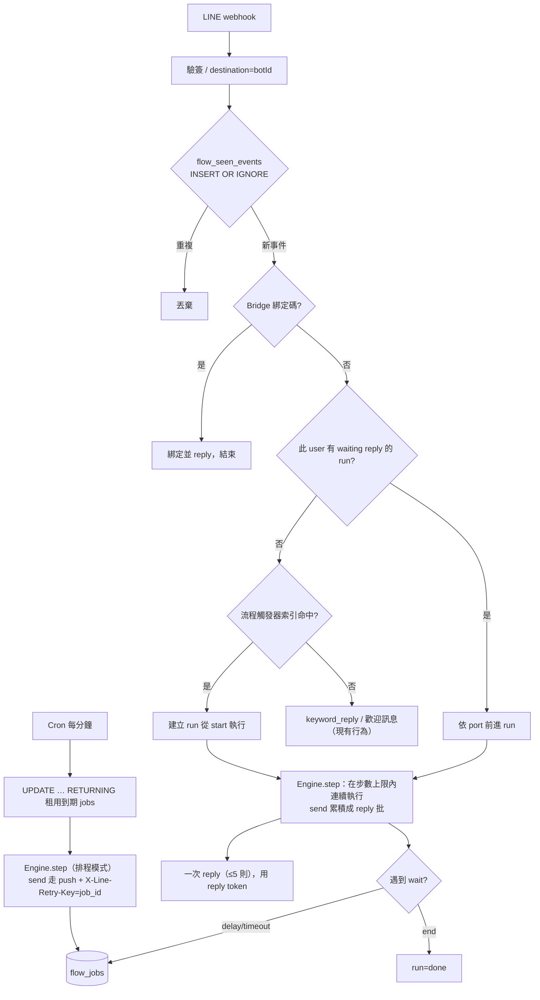

# Flow Designer 架構審查與目標設計（2026-11-18）

> 範圍：`pages/flow_designer*.html`、`pages/flow_editor.html`、`js/flow_designer.js`（5,357 行）、`js/flow_designer_data_loader.js`、`js/flow_node_adapter.js`、`js/flow_editor.js`、`worker_src/handler/flow.js`，以及 webhook／事件處理／KV schema／Bridge 的相關部分。
> 審查方式：只讀程式碼與文件；另在 scratchpad 用 jsdom + `dompurify@3.0.6`（與 `flow_designer_full.html:743` 載入的版本相同）實測 sanitizer 行為。`npm test` 基準：1836 pass / 0 fail（沒有任何一個測試涵蓋 flow）。
> 標記慣例：**[已驗證]** 有程式碼行號或實測；**[推測]** 根據程式碼推論、未實機確認；**[假設]** 平台或 LINE 的外部事實，見第六節。

---

## 0. 一句話結論

Flow Designer 目前是一個**畫布編輯器**，加上一組**存 JSON 的 CRUD API**。它**沒有執行引擎**，存下來的流程不會影響任何 LINE 使用者看到的內容。畫布本身在 2026-06 的 XSS 修正之後，有一批核心互動已經失效。真正該做的不是「把設計器收尾」，而是先定義「流程」在執行時代表什麼，再做一個最小的執行器（D1 存狀態、Cron 跑排程），最後把編輯器縮成只產生這份契約的工具。

---

## 1. 現況理解

### 1.1 文件宣稱 vs 程式碼實際

| 項目 | 文件宣稱 | 程式碼實際 |
|---|---|---|
| 核心功能 | `FLOW_DESIGNER_PLAN.md:14-20` 把「流程儲存/載入、即時預覽、流程測試」都標成 ✅ | 儲存/載入有。**沒有「流程測試」**：沒有模擬器，也沒有 `/flow/test`。Phase 1–7 的勾選清單（`PLAN.md:242-283`）大多仍是 `[ ]` |
| 後端端點 | `PLAN.md:88-98` 列出 `/flow/test`、`/flow/execute/:id`、`/flow/logs/:id` | 只有 `list/save/get/delete/versions`（`worker_src/handler/flow.js:202-232`） |
| 延遲節點用途 | `BRAINSTORM.md:19` 說用 `action_delay` 做「療程後 3 天自動發送術後衛教」 | 延遲節點只是畫布上的方塊。後端完全沒有讀它的程式碼，wrangler 也沒有設定 Cron 或 Queue（`wrangler.jsonc:90-94` 的 queues 是註解） |
| 連線/迴圈 | `flow_designer_session_log_2025-12-15.md`「Richmenu 之間無法連接 → 暫時禁用循環檢測」 | 循環檢測**又被打開了**（`flow_designer.js:1565`）。依據是 `docs/archive/flow_designer_improvement_report.md:28-37`，理由是「避免後端執行時無限遞迴」，但這個後端並不存在 |
| 多 bot | `kv_schema.js:116-119` 已經定義 `BotKeys.flow*` | `flow.js` 仍用舊的 `flow_${userId}_${botId}_…` key，而且 botId 實際上永遠是 `"default"`（見 H1） |
| 即時同步 | `FLOW_DESIGNER_REALTIME_SYNC.md` 說側欄用 `oninput` 即時更新 | 這段 `oninput` 現在會被 DOMPurify 移除（見 C3） |
| 版本 | `ISSUES.md:297-306` FEAT-001 說後端已有版本儲存、缺 UI | 每次存檔都寫一筆 30 天 TTL 的快照（`flow.js:82-85`）。沒有還原 API、沒有發布狀態，也沒有「哪個版本正在生效」的概念 |

### 1.2 資料模型（實際存進 KV 的樣子）

`saveFlow()`（`js/flow_designer.js:4650-4675`）直接把記憶體裡的 `this.nodes` / `this.edges` 原封送出：

```jsonc
{
  "id": "flow_<userId>_<ts>_<rand>",         // flow.js:52-54，id 內含 LINE userId
  "name": "…", "botId": "default",            // 見 H1
  "nodes": [{
    "id": "node_<ts>_<rand>",
    "type": "richmenu|keyword|message_text|…",
    "position": {"x":0,"y":0},
    "data": { /* 依類型而異；可能含整份 flex contents、blob: 圖片 URL */ },
    "config": { "label":"…","icon":"…","color":"…","category":"…" }   // UI 常數也被存進去（flow_designer.js:941-947）
  }],
  "edges": [{ "id":"edge_…","source":"node_…","sourceHandle":"btn_0|button_0|default|null","target":"node_…","targetHandle":"input|null" }],
  "updatedAt":"…","createdAt":"…"
}
```

- **沒有 schema 版本欄位**，沒有 `trigger` 欄位，也沒有 `status`（草稿/發布）。
- `sourceHandle` 有四種寫法：`btn_${i}`（手動從 richmenu 按鈕拉線，`flow_designer.js:2451` + `flow_designer_data_loader.js:129`）、`button_${i}`（自動展開，`:3426`）、`'default'`（一般輸出點，`:1934`）、`null`（menu switch，`:3414`）。執行器無法可靠地把「按鈕 i」對到「這條邊」。
- richmenu 節點的 `imageUrl` 是 `URL.createObjectURL()` 產生的 `blob:` URL（`flow_designer_data_loader.js:116-118`）。它會被存進 KV，重新載入後就失效。

### 1.3 節點類型清單與後端支援

`NodeTypes` 在 `flow_designer.js:23-46`，`NodeTypeConfig` 在 `:51-147`。

| 節點 | 能加到畫布 | 能編輯 | 後端是否執行 | 備註 |
|---|---|---|---|---|
| `richmenu` | ✓ | 選擇既有選單（唯讀映射） | ✗ | 畫線不會改變 LINE 上按鈕的行為（見 C2） |
| `keyword` | ✓ | 只能選既有 keyword，欄位 readonly（`:3031-3045`） | ✗（keyword_reply 獨立運作） | UI 提供 contains/regex，但後端只做「不分大小寫的完全比對」（`lib/keyword_matcher.js`） |
| `webhook` | ✗ | ✗ | ✗ | 有 type 但沒有 config，`addNode` 會報錯（`:934-939`） |
| `message_text` | ✓ | ✓ | ✗ | |
| `message_image` | ✓（調色盤 `flow_designer_full.html:594`） | ✗ | ✗ | 沒有預設資料（`getDefaultNodeData` 會回 `{label:'未知節點'}`），也沒有編輯器 |
| `message_flex` | ✓ | 選既有 flex，內容**複製一份**進節點 | ✗ | 和 flex 庫之後的修改脫鉤 |
| `message_imagemap` | ✓ | 選既有 | ✗ | |
| `message_sequence` | ✓ | 最多 5 則、「訊息間延遲 ms」 | ✗ | LINE 一次 reply 就送 5 則，「訊息間延遲」在 reply 模型下沒有意義 |
| `action_delay` | ✓ | 側欄 1–300 秒（`:3053-3064`）／雙擊 0–86400 秒（`flow_node_adapter.js:316-359`） | ✗ | 兩處範圍不一致，也都做不到「3 天」 |
| `action_condition` | ✓ | 雙擊可編多條件（`flow_node_adapter.js:505-613`） | ✗ | 多條件之間是 AND 還是 OR 沒有定義；輸出固定 true/false |
| `action_api` | ✗（沒有 config） | 有編輯器（`flow_node_adapter.js:618-712`） | ✗ | headers 以明文存在 flow JSON 裡 |
| `action_tag` | ✓ | ✓ | ✗ | 和 keyword_reply 的 `addTags`、postback 的 `tag=` 是三套平行機制 |
| `url` / `postback` | ✓ | ✓ | ✗ | 它們是「按鈕動作」，不是「步驟」，類別定位混淆 |
| `end` | ✓ | — | ✗ | |

**結論：全部 0/16 有後端執行支援。** [已驗證：在 `worker_src/` grep `flow`，只會命中 `handler/flow.js`、`index.js` 路由、`kv_schema.js`、`auth_routes.js` 與一行註解]

### 1.4 儲存位置、版本、多 bot

- **KV key**：`flow_${userId}_${botId}_${flowId}`、`flow_list_${userId}_${botId}`、`flow_version_${userId}_${botId}_${flowId}_${ts}`（`flow.js:6-11, 82`）。沒有走 `bot_store` / `BotKeys`，`RESOURCES` 表（`bot_store.js:66`）裡也沒有 flow。
- **botId 來源**：`getActiveBotId()`（`flow.js:14-33`）先看 `X-Bot-Id` header，再讀 `token_${userId}`。但前端從不送 `X-Bot-Id`（全庫只有 Bridge 頁面送），後端也沒有任何地方寫入 `token_${userId}`，所以結果**永遠是 `"default"`**。[已驗證：grep]
- **授權**：`/flow` 只經過 `authenticate`（`index.js:131-140`），沒有 `withPermission`。資料綁的是呼叫者本人，所以受邀的團隊成員看不到 owner 的流程。
- **前端草稿**：只有一個 localStorage key `flow_designer_draft`（`:4831-4841`），不分 bot；切換 bot 時才清掉（`:5161` 之後的初始化區）。

### 1.5 和 keyword reply / richmenu / flex 的關係

設計器是這些既有資源的**唯讀映射加副本**：

- 「展開 Richmenu 按鈕」（`:3208-3453`）讀 LINE richmenu 的 `areas`，把每個 action **反推**成畫布節點。`message` 會嘗試對應 keyword，`richmenuswitch` 會遞迴展開。
- 在畫布上拉的線、改的文字，**不會寫回** richmenu、keyword 或 flex。LINE 上按鈕的行為仍然由 richmenu 本身的 action 決定。
- `matchKeyword()`（`:3135-3159`）只認得 `kw.matchType` 等於 `exact/contains/regex` 的項目，但後端存的 keyword 物件**沒有** `matchType` 欄位（`keyword_reply.js:18-23`）。所以自動展開**永遠對不到 keyword**，一律退回建立 text 節點。[已驗證]

### 1.6 Runtime：webhook 今天做什麼

`webhook.js:173-185` 只分派 `message / follow / unfollow / postback` 四種事件：

- **message**（`event_handler.js:185-347`）：先試 Bridge 綁定碼，再做 keyword 完全比對；有命中就 reply。完全沒有「這個使用者正在某個流程裡等回覆」的概念。
- **follow**（`:351-396`）：寫會員資料、同步分眾選單、送歡迎訊息。
- **postback**（`:418-468`）：解析 `tag=`/`untag=`，然後**一律回覆 `✅ 已收到您的操作：${postbackData}`**，把原始 data 原樣回顯給使用者。
- **沒有事件去重**：沒有讀 `webhookEventId`，也沒有讀 `deliveryContext.isRedelivery`。[已驗證：grep 無結果]
- 事件在 `ctx.waitUntil` 裡**依序**處理（`webhook.js:102-120`）。Worker 沒有 `scheduled()` handler；`queue()` handler 存在（`index.js:200-203`），但沒有綁定任何 Queue。

---

## 2. 缺口與問題（依嚴重度）

### Critical

#### C1. 沒有執行引擎，「流程」目前不會產生任何效果
- **位置**：整個 `worker_src/`。`wrangler.jsonc` 沒有 `triggers.crons`，`queues` 被註解掉（`:90-94`），也沒有 Durable Object。
- **為何是問題**：BRAINSTORM 裡最有價值的三個情境（術後追蹤、預約提醒、7 天漏斗）全都靠「延遲後再送」和「依回覆分支」。編輯器做得再完整，使用者存了流程也什麼都不會發生。
- **情境**：美業店家畫好「療程後 3 天送衛教」，存檔顯示 ✅，結果客人什麼都沒收到，也沒有任何錯誤訊息。
- **建議**：見第三節。在執行器存在之前，UI 應該明確標示「草圖模式，尚不會執行」，避免使用者誤以為已經上線。

#### C2. 「流程」的語意沒有定義：它是「現有設定的地圖」，還是「可執行的程式」？
- **位置**：`expandRichmenuButtons`（`:3208`）、`selectKeyword`（`:3696`）、`renderRichmenuProperties`（`:2845-2880`）。
- **為何是問題**：從 richmenu 按鈕畫一條線到 Flex 節點，在 LINE 上什麼都不會改變，因為按鈕的 action 是 richmenu 自己的 `message`/`postback`/`uri`。要讓這條線「生效」，只有兩條路：
  (a) 發布時改寫 richmenu 的 action，讓它變成流程專用的 postback；
  (b) 讓執行器去攔截「按鈕送出的文字或 postback」。
  兩條路對 richmenu 管理頁的所有權影響完全不同。這件事不先決定，任何執行器都寫不出來。
- **建議**：拆成兩個產品面。**結構地圖**（唯讀視覺化，保留現有的自動展開）和**自動化流程**（Journey：有自己的觸發器與狀態，是本文第三節的主體）。richmenu 在 Journey 裡只能是「動作：切換/綁定選單」或「觸發來源：某個 postback」，不再是一個「有多個輸出的節點」。這是第五節的決策 D1。

#### C3. 2026-06 的 XSS 修正讓編輯器的核心互動全部失效（回歸）
- **位置**：commit `7ae613b`（2026-06-07）把 `renderNode`（`:1197`）與 `showNodeProperties`（`:2789`）改成 `setInnerHTML`。DOMPurify 載入時，`setInnerHTML` 會用預設設定消毒（`helper/security.js:47-53`）。
- **實測 [已驗證，jsdom + dompurify@3.0.6]**：`onclick`、`oninput`、`onchange`、`onmousedown`、`` 全部被移除。`flow_designer.js` 裡有 22 處 inline handler 受影響，包括：
  - richmenu 圖片的 `onload="flowDesigner.drawRichmenuButtons(…)"`（`:1097`）。這是**每個按鈕各自一個輸出點**唯一的繪製入口，所以 richmenu 多輸出現在畫不出來（imagemap 的 `:1142` 也一樣）；
  - 屬性面板的「載入 Richmenu / 展開所有按鈕 / 刪除節點」按鈕、文字與延遲輸入框（`:2855-3086`）；
  - 節點上的縮放按鈕、部分輸出點的 `onmousedown`（`:1124, 1164, 1186`）。
- **仍然能用的部分**：用 `addEventListener` 綁定的預設輸出點（`:1268-1271`）、雙擊開啟的 `FlowNodeAdapter` 編輯器（純 DOM 建構）、調色盤。
- **反過來的情況**：DOMPurify 從 CDN 載入失敗時，`safeHTML` 會 fail-closed 成純文字，整張節點變成字面 HTML。[推測：未在瀏覽器實機確認，但兩條路徑的程式都很單純]
- **建議**：不要為了相容而放寬 DOMPurify（例如 `ADD_ATTR: ['onclick']`），那等於把修好的 XSS 洞再打開。正確做法是改成 `data-action` 加事件委派（一個 container listener），並補一個 jsdom 測試鎖住「渲染後的節點必須有可互動的輸出點」。

### High

#### H1. 多 bot 隔離與團隊授權實質上不存在
- **位置**：`flow.js:14-33`（botId 永遠是 `"default"`）、`flow.js:6-11`（key 綁 userId）、`index.js:180`（沒有 `withPermission`）。
- **情境**：owner 管兩個官方帳號，在 A 畫的流程切到 B 一樣看得到；受邀的 admin 看不到任何流程；執行器上線後，webhook 只知道 `destination`，**根本找不到**某個 bot 的流程。
- **附帶問題**：前端草稿只有一個 key，切換 bot 時清草稿的時機和 30 秒 autosave（`:4843-4850`）有競態，可能把 A 的畫布存成 B 的 flowId。[推測]
- **建議**：改用 `BotKeys.flow*`（`bot:${botId}:flow:*`），botId 由 `withPermission` 注入的權威值決定；權限定為 editor 可存草稿、admin/owner 可發布。既有資料預期很少，舊 key 讀一次搬過去即可，不必走 bot_store 的雙讀雙寫（決策 D7）。

#### H2. 沒有對話狀態儲存；如果直接用 KV 做，在重送與併發下會出錯
- **為何是問題**：「等待回覆」「條件分支」「延遲後繼續」都需要 per-(bot, user, flow) 的游標和變數。KV 是 last-write-wins、跨 PoP 最終一致、沒有條件寫入 [假設，見 §6]。只要同一個使用者連續兩則訊息，或 LINE 重送同一事件，兩個 invocation 就會各自讀到 `waiting_reply` 並各自前進，造成重複 push 或分支錯亂。
- **現有佐證**：Bridge 已經因為同樣的原因把冪等與計數搬到 D1（`ARCHITECTURE_PLATFORM.md:338`、`bridge/db.js` 的 `INSERT … ON CONFLICT` 與 `RETURNING`）。
- **建議**：run 狀態、排程工作、事件去重都放 D1，用條件式 `UPDATE … WHERE version=?` 推進（§3.4）。

#### H3. Webhook 沒有事件去重與冪等
- **位置**：`webhook.js:102-120`、`event_handler.js` 全檔。
- **情境**：今天的後果只是「重送時 reply token 已用過，LINE 回錯誤」，相對無害。一旦有執行器，重送就會讓流程前進兩次，而延遲後的動作是 **push（計費）**，會真的發兩則給客人。
- **附帶問題**：postback 會原文回顯（`event_handler.js:459-463`）。一旦流程把內部 id 編進 postback，這些 id 會直接顯示給客人看。
- **建議**：用 `webhookEventId` 做 D1 `INSERT OR IGNORE` 去重（保留約 3 天）；push 一律帶 `X-Line-Retry-Key`（`lib/line_api.js:48-49` 已支援）；流程用的 postback 必須在回顯之前被攔截。

#### H4. 連線模型與迴圈政策互相矛盾
- **位置**：`createEdge`（`:1547-1586`）、`wouldCreateCycle`（`:2245-2266`）。
- **為何是問題**：對話流程本來就需要迴圈。PLAN 自己的兩個範例（`PLAN.md:33`「返回主選單」、`:55`「格式錯誤 → 返回輸入電話」）在目前的規則下都畫不出來。richmenu 分頁 A↔B 互相切換時，自動展開會建立 A→switch→B→switch→A，最後那條邊會被擋掉，只剩一個 toast。另外 `pushHistory()` 在循環檢查**之前**執行（`:1562`），被拒絕的操作也會留下一筆 undo 紀錄。
- **建議**：迴圈要允許，但規則改成「**每個環上至少要有一個等待節點**（等回覆或延遲）」，在發布時做靜態檢查，執行時再加步數上限（§3.6）。不要在編輯時一律禁止。

#### H5. 節點 schema 有三份來源，後端零驗證
- **位置**：`NodeTypeConfig`、`getDefaultNodeData`（`:965-1021`）、屬性面板（`:2819-3104`）、`FlowNodeAdapter`，各自定義欄位與範圍；`handleSaveFlow` 只檢查 512KB 和 200 節點（`flow.js:67-73`）。
- **具體不一致**：延遲 1–300 秒 vs 0–86400 秒；`action_api`、`webhook` 有 type 但不能新增；`message_image` 沒有預設資料也沒有編輯器；keyword 的 contains/regex 後端不支援；condition 的 AND/OR 沒有定義；edge 的 handle 命名有四種（§1.2）；任意 JSON 都能存，也能匯入（`importFlow` 沒有驗證，`:4869-4886`）。
- **建議**：寫一份**共用、無 DOM 依賴**的 schema 與 validator 模組，前後端都 import（§3.2、§3.9）。後端在發布時拒絕不合法的流程。

#### H6. 存檔可靠性
- `createdAt` 每次存檔都被覆蓋：前端更新時送 `createdAt: undefined`（`:4658`），後端寫 `body.createdAt || now`（`flow.js:64`）。[已驗證]
- 流程清單 index 是 KV 的讀改寫（`flow.js:88-93`、`:128-131`），兩個新流程同時存，可能讓其中一個從列表消失。[推測，KV 非原子]
- 沒有 `rev` 欄位或樂觀鎖：兩個分頁、或 autosave 加手動存檔，會互相覆蓋。
- 每次存檔（包含 autosave）都多寫一筆版本快照，沒有還原 API；`listVersions` 沒處理 cursor（KV list 一次最多 1000 筆 [假設]），而且會逐筆 `get`。
- **建議**：草稿加上 `rev`，不符就回 409。發布版本存在 D1，不可變、編號遞增；「回滾」就是把 `active_version` 指回舊版本。

### Medium

| # | 問題 | 位置 | 建議 |
|---|---|---|---|
| M1 | `action_api` 的設計會帶來 SSRF 與機密外洩：任意 URL/method，headers 以明文存在 flow JSON（任何能讀流程的人都看得到 token） | `flow_node_adapter.js:618-712` | MVP 不做。以後要做的話：只允許 https、網域白名單、禁止私有 IP 與 localhost、限制逾時與回應大小；機密以「憑證名稱」引用（存加密區，比照 token 加密計畫），永遠不放進流程定義 |
| M2 | 變數替換與 regex 條件。現有 `replaceMessageVariables`（`event_handler.js:108-154`）只處理 text 與 altText；流程如果把使用者輸入放進 URI 或 postback，就可能注入。使用者可自訂的 regex 在 Worker 的 CPU 上限下有 ReDoS 風險 [假設] | — | 變數只能用白名單，只能插進 text 欄位，並限制長度；條件運算子 MVP 只提供 equals / contains / in-list / tag-has，regex 延後 |
| M3 | 沒有可觀測性：看不到哪個流程被誰觸發、停在哪、為何失敗（`ISSUES.md` FEAT-002 已提） | — | 加 `flow_run_steps` 只增不改的紀錄表，加上 run 檢視頁（§3.8） |
| M4 | 前端單檔 5,357 行、透過 `window.flowDesigner` 全域、22 處 inline handler、零測試；頁面從 unpkg 載入**未鎖版本**、而且**沒有被使用**的 `react@18`、`react-dom@18`、`reactflow`（`flow_designer_full.html:732-734`），平白多了供應鏈風險與載入成本 | — | 移除 React CDN；把純資料邏輯（model / validator / 序列化）抽成可用 `node:test` 測試的 ES module；畫布層保留 |
| M5 | 唯一的 flow 測試 `tests/test_flow_api.mjs` 打線上 dev worker、用 `X-User-Id`（liff 模式下會 401），而且不在 `npm test` 範圍 | `tests/test_flow_api.mjs:16-48` | 改寫成 `tests/unit/test_flow_*.mjs`，用 `createMockKV` / `createTestD1` |
| M6 | 觸發器衝突沒有規則：同一個關鍵字可能同時存在於 keyword_reply、多個流程與 Bridge 綁定碼 | `event_handler.js:196-228` | 固定優先序（§3.3），並在發布時檢查衝突 |
| M7 | Flex 內容以副本方式嵌進節點，之後在 flex 庫修改不會反映到流程；反過來，流程如果改成「引用 id」，進行中的 run 又會因為素材被修改而變調 | `selectFlex` `:3650` | 草稿用引用 id，**發布時做快照**（決策 D5） |

### Low

- L1：`pages/flow_editor.html` 用 `/pages/flow_designer_full.html` 這種絕對路徑，沒考慮 `MOUNT_PATH=/lm`。[推測：正式路由 `imhoti.tw/lm*` 之下，這個 iframe 可能 404；未確認這一頁是否還有入口]
- L2：`index.html:411-412` 用 `?userId=` 把 LINE userId 放進網址（會進瀏覽紀錄或 referrer）。
- L3：`flowId` 路徑參數沒有驗證（只影響自己的命名空間）；flowId 本身含有 userId（`flow.js:54`），會出現在網址與 log。
- L4：文件把 PLAN 的核心功能、GUIDE 的「已完成」都標成 ✅，但實際狀態落後（§1.1）。建議把這些文件移到 `docs/archive/`，以本文與之後的規格為準。

---

## 3. 目標架構設計

設計原則：**先能執行一個情境，再談通用**。不追求 n8n 那種任意圖。節點數量要少、契約要明確，每個節點都能單獨測試。

### 3.1 概念模型

```
Flow（流程）          一個 bot 底下的一份自動化定義；有草稿與多個已發布版本
 └ FlowVersion        不可變；執行一律綁定某個版本
Run（執行實例）       (bot, LINE user, flow) 在某個版本上的一次執行；有游標與變數
 └ Step log           每一步的執行紀錄（只增不改）
Job（排程工作）       「某個 run 在某個時間點要繼續」；延遲與等待逾時都靠它
```

### 3.2 流程定義 JSON（schema v1，發布後的形狀）

```jsonc
{
  "schema": "lm.flow/1",
  "flowId": "f_8k2j",                 // 短 id，不含 userId（postback 預算有限）
  "version": 3,
  "name": "玻尿酸術後關懷",
  "trigger": {                        // 每個流程只有一個入口，衝突檢查才做得到
    "type": "tag_added",              // keyword | follow | postback | tag_added | external_event
    "tag": "術後_玻尿酸"
  },
  "policy": {
    "reentry": "ignore_if_active",    // 決策 D3
    "maxPushesPerRun": 6,
    "quietHours": { "tz": "Asia/Taipei", "from": "21:30", "to": "09:00" },  // 決策 D6
    "escapeKeywords": ["取消", "停止"]
  },
  "start": "n1",
  "nodes": {
    "n1": { "type": "wait.delay", "duration": "P3D", "next": "n2" },
    "n2": { "type": "send", "messages": [ { "ref": "flex:abc", "snapshot": { /* 發布時凍結 */ } } ],
            "quickReplies": [ { "label": "很好", "port": "ok" }, { "label": "有點不舒服", "port": "bad" } ],
            "next": "n3" },
    "n3": { "type": "wait.reply", "timeout": "P2D",
            "ports": { "ok": "n4", "bad": "n5", "text": "n5", "timeout": "n6" } },
    "n4": { "type": "tag", "add": ["術後_良好"], "next": "end" },
    "n5": { "type": "notify.staff", "channel": "bridge_event", "event": "aftercare.flagged", "next": "end" },
    "n6": { "type": "end" }
  },
  "layout": { "n1": {"x":100,"y":80} }   // 畫布座標與語意分開；執行器不讀
}
```

- 邊不再是獨立陣列，改成**節點自己宣告**的 `next` / `ports`。每種節點能有哪些 port 由型別契約決定，不會再出現 `btn_0` 和 `button_0` 並存。
- 編輯器內部仍然可以用 `nodes[] + edges[]` 表示，存檔時序列化成上面的形狀。轉換函式放在共用模組，並有測試。

### 3.3 節點契約（MVP 只做這 8 種）

| type | 輸入參數 | 輸出 port | 執行語意 | 送訊方式 |
|---|---|---|---|---|
| `send` | 1–5 則訊息（引用加快照）、可選 quick reply | `next` | 把訊息加進「本步驟訊息批」 | 同步步驟內用 reply；排程步驟用 push |
| `wait.delay` | `duration`（ISO 8601，最短 1 分鐘）或 `until`（變數＋偏移，例如 `appointment_at - P1D`） | `next` | 建立 Job，run 進入 waiting，**結束本次執行** | — |
| `wait.reply` | `timeout` | `<quick reply 的 port>`、`text`、`timeout` | 先記錄狀態再結束；下一則訊息或 postback 進來時依 port 前進 | — |
| `branch` | 條件清單（tag-has / var equals / text contains / in-list），**依序，第一個成立的勝出** | `case_i…`、`else`（必填） | 純計算 | — |
| `tag` | add / remove | `next` | 寫會員標籤（沿用 `tag_system`） | — |
| `richmenu.link` | richMenuId 或 alias | `next` | 呼叫 LINE link richmenu API | — |
| `notify.staff` | 事件名稱 | `next` | 經 Bridge 或 webhook 外送通知店家（不含 LINE userId） | — |
| `end` | — | — | run 設為 done | — |

觸發器（只能放在 `trigger` 欄位，不是節點）：`keyword`（與 keyword_matcher 一樣是完全比對）、`follow`、`postback`（流程自己產生的按鈕）、`tag_added`、`external_event`（Bridge）。

延後再做：`action_api`（M1）、regex 條件、A/B、子流程、AI 節點。

### 3.4 狀態與排程存放：選 D1

| 選項 | 優點 | 缺點 | 結論 |
|---|---|---|---|
| KV | 已在用、讀取快 | 沒有條件寫入、跨地區最終一致、免費方案寫入額度低 [假設] | 只放**流程草稿**和**觸發器索引**（讀多寫少、能容忍延遲） |
| **D1** | 原子的條件更新、`RETURNING`（`bridge/db.js:851` 已在用）、可以查詢（找出到期的 job、查 run 狀態）；團隊有經驗，也有 `tests/helpers/mock_d1.mjs` | 有寫入額度與延遲 [假設]；單一資料庫是單一區域 | **run、job、事件去重、step log、發布版本都放這裡** |
| Durable Objects | 每個使用者天然串行，alarm 能精準計時 | 新的程式模型、測試與部署成本、方案限制 [假設] | 目前不用；等出現「同一使用者高併發」或「需要秒級計時」再評估 |
| Queues | 適合大量扇出 | 依 wrangler 註解需要付費方案、目前沒有綁定 | 不用；Cron 掃 D1 足以應付分鐘級延遲 |

建議另開一個 D1 binding `FLOW_DB`，SQL 只寫在 `worker_src/flow/db.js`，比照 Bridge 的邊界測試。這樣不會和 Bridge 的遷移與權限互相纏在一起。如果 Tim 偏好只維護一個資料庫，也可以共用 `BRIDGE_DB` 但用不同的表前綴（決策 D8）。

```sql
-- 草案，不是遷移檔
flow_versions(bot_id, flow_id, version, definition_json, published_by, published_at,
              PRIMARY KEY(bot_id, flow_id, version))
flow_active(bot_id, flow_id, active_version, trigger_key, PRIMARY KEY(bot_id, flow_id))
flow_runs(run_id PK, bot_id, flow_id, version, line_user_id, status /*active|waiting|done|failed|cancelled*/,
          cursor, wait_kind, vars_json, steps, pushes, rev, created_at, updated_at)
  -- UNIQUE(bot_id, flow_id, line_user_id) WHERE status IN ('active','waiting')
flow_jobs(job_id PK, run_id, due_at, kind /*resume|timeout*/, status /*pending|leased|done|dead*/,
          lease_until, attempts, INDEX(status, due_at))
flow_seen_events(bot_id, webhook_event_id, seen_at, PRIMARY KEY(bot_id, webhook_event_id))
flow_run_steps(run_id, seq, node_id, outcome, detail_code, at, PRIMARY KEY(run_id, seq))
```

`line_user_id` 只存在 LM 核心的 run 表裡（因為延遲後必須能 push），不進 step log、不進 Bridge 的回應或稽核，符合 CLAUDE.md 的 Bridge 邊界。

### 3.5 執行模型



**引擎核心**是純函式：`step(definition, runState, input) → { newState, effects[] }`。effects 包括 `reply`、`push`、`tag`、`linkRichMenu`、`schedule`、`notify`。由外層的 adapter 去執行 effects 並寫 D1。這樣模擬器、重播和單元測試都直接呼叫 `step`，不必碰 LINE。

**推進一個 run 的交易語意**：
1. 讀 run（含 `rev`）。
2. 呼叫 `step` 算出新狀態與 effects。
3. `UPDATE flow_runs SET … , rev=rev+1 WHERE run_id=? AND rev=?`。影響 0 列代表別人先推進了，放棄這次執行，不做任何 effect。
4. 成功後才執行 effects。

effect 執行失敗時：reply 就放棄，並記錄 `reply_failed`；push 交給 job 重試（同一個 retry key，所以 LINE 端不會重複投遞）。

**reply 與 push 的取捨**：
- 同步步驟（由 webhook 觸發）裡所有 `send` 合併成一次 reply，最多 5 則；超過 5 則在發布時就拒絕。reply token 只在本次事件處理中使用，**絕不寫入 D1**。
- 任何 `wait.*` 之後的 `send` 都是 push（會計費）。編輯器要在這些節點上顯示「推播・計費」標記，發布時也要估算每個 run 最多會 push 幾則。
- reply token 的有效時間當成 30 秒來設計（沿用 `ARCHITECTURE_PLATFORM.md` 的保守值，§6）。超時就**不改用 push**，只記錄 `reply_expired`。是否要改成 push 補送由 D4 決定。

**等待回覆的路由**：message 或 postback 進來時，先查這個使用者是否有 `status='waiting' AND wait_kind='reply'` 的 run（每個 bot、每個使用者最多一個；若多個流程同時在等，依 D3 的規則決定）。流程的 postback data 格式：`lf=1&f=<flowId>&v=<ver>&n=<nodeKey>&p=<port>&r=<runShort>`，控制在 300 字元以內 [假設，§6]。如果按的是舊訊息上的按鈕（run 不存在、已結束，或已經不在等這個節點），就安靜忽略或回一句固定說明，**不回顯 data**。

### 3.6 冪等、重試、成本護欄

| 風險 | 機制 |
|---|---|
| LINE 重送事件 | `flow_seen_events` 以 `webhookEventId` 去重（主鍵衝突即視為重複） |
| 兩個 invocation 同時推進同一個 run | `rev` 樂觀鎖（§3.5） |
| Cron 重疊或 worker 被回收 | job 租約：`UPDATE … SET status='leased', lease_until=now+120s WHERE status='pending' AND due_at<=now … RETURNING`；租約過期自動回到可領取狀態 |
| push 重送 | `X-Line-Retry-Key` = 由 job_id 衍生（沿用 `bridge/retry_key.js` 的作法） |
| 無限迴圈 | 發布時：每個環上必須有 `wait.*`。執行時：單次 step 最多 25 個節點、每個 run 的 push 不超過 `maxPushesPerRun`、每個 run 最長存活 90 天 |
| 帳單爆量 | 每個 bot 的每日 push 預算（比照 `bridge/quota.js` 和 D1 counters 的 `takeToken`）；接近上限時通知 owner，超過就把 job 延後或標成 dead，不送 |
| 半夜打擾 | `quietHours`：到期時間落在區間內就往後推 |
| 失敗重試 | job 指數退避，最多 5 次，之後進 `dead` 並寫 step log；LINE 回 4xx（封鎖等）視為確定性失敗，run 設為 `failed`，不重試 |

### 3.7 觸發器匹配與優先序

1. Bridge 綁定碼（現有，必須第一個）。
2. 正在 `wait.reply` 的 run（含 escape keyword：命中就取消 run）。
3. 已發布流程的觸發器（KV `bot:{botId}:flow_triggers` 索引，發布時重建，可容忍約 60 秒延遲）。
4. keyword_reply、歡迎訊息（現有行為，不變）。

發布時檢查：同一個 bot 裡，兩個已發布流程不能有相同的 keyword 觸發器。和 keyword_reply 重疊時要警告，並說明「流程優先」（決策 D2）。

### 3.8 可觀測性與除錯

- `flow_run_steps` 記錄每個節點的結果（`sent` / `skipped_quiet_hours` / `reply_expired` / `push_failed:403`），只存代碼，不存訊息內容，保留 30 天。
- 後台「執行紀錄」頁：依流程顯示 run 狀態分布、卡住的 run、dead job；單一 run 可以展開查看步驟。顯示 LINE 使用者時用會員的顯示名稱，不顯示原始 userId。
- **模擬器**：`POST /flow/simulate` 接收草稿定義和一串假事件（文字、postback、「時間快轉 3 天」），回傳 effects 的逐字稿。不碰 LINE，也不寫 D1，因為直接呼叫純函式 `step`。編輯器的「測試」按鈕就接這個。
- **重播**：拿 `flow_run_steps` 和當時的版本定義重新計算一次，比對是否一致，用來除錯和做回歸測試。

### 3.9 與現有系統的整合點

- **Bridge**：
  (a) `external_event` 觸發器：產品透過受限端點送出 `{external_contact_ref, event:"appointment.booked", vars:{appointment_at}}`，LM 解析綁定後啟動 run（需要新增 scope，例如 `flows:trigger`）；
  (b) `notify.staff` 透過 Bridge 外送事件給產品。
  兩者都延後到 MVP 之後；MVP 先用 `tag_added` 加後台手動標記來觸發。
- **標籤**：`tag` 節點和 `tag_added` 觸發器共用 `lib/tag_system.js`。會員頁打標籤時要發出「tag_added」內部事件，讓引擎能接手。這是 MVP 唯一必須改到既有 handler 的地方。
- **richmenu / flex**：只以 id 引用，發布時快照。結構地圖（唯讀）保留現有的展開邏輯。
- **共用 schema 模組**：放一個沒有 DOM、也沒有 Worker API 依賴的 ES module（例如 `js/shared/flow_schema.js`），前端直接 import，後端用 wrangler 打包時 import 同一份。[推測：wrangler 的 esbuild 可以 import `worker_src/` 以外的相對路徑，需要實測]

### 3.10 測試策略

| 層 | 測試 | 工具 |
|---|---|---|
| schema / validator | 合法與不合法定義、環上沒有 wait、port 不完整、超過 5 則訊息、觸發器衝突 | `node:test` 純函式 |
| 引擎 `step` | 每種節點的輸出入；表格驅動；假時鐘 | `node:test` |
| 持久層 | rev 衝突、job 租約過期、事件去重、唯一 active run | `tests/helpers/mock_d1.mjs`（真 D1） |
| webhook 整合 | 優先序（綁定碼 > 等待中 run > 觸發器 > keyword）、重送不重複、postback 不回顯 | 現有 webhook 測試模式加 `createMockKV` |
| 情境測試 | 「術後 3 天」完整劇本：觸發 → 快轉 → push → 回覆 → 分支 → 標籤 | 模擬器 API |
| 前端 | 序列化往返（畫布 ↔ schema）、渲染後輸出點可互動（防 C3 回歸） | `node:test` + jsdom（目前 repo 沒有 jsdom 依賴，需要新增 devDependency） |

---

## 4. 分階段路線圖

### 為什麼 MVP 選「美業／診所術後關懷」

- BRAINSTORM 的 PM 建議本來就收斂在這裡（`BRAINSTORM.md:40-47`），而且它恰好只需要最小的原語組合：**延遲 → push → 快速回覆 → 分支 → 標籤／通知**。
- 每個 run 的 push 數量少而可預期（2–4 則），成本可控，也容易向店家說明。
- 同一組原語可以直接支撐創作者的「7 天漏斗」（延遲加 push 的鏈）。團購主情境的價值主要在分眾推播，不在流程，所以不適合當流程的 MVP。
- 「預約前一天提醒」需要預約時間這個外部資料，依賴 Bridge 的 `external_event`，放在 Phase 3。

### Phase 0：止血與定義（約 2–4 天）

- **產出**：
  1. 修 C3：inline handler 改成事件委派，加 jsdom 測試；
  2. 修 `createdAt`、移除 React CDN、UI 加上「草圖模式（尚不會執行）」標示；
  3. 流程儲存改走 `bot:${botId}:flow:*` 加 `withPermission`，並補 `tests/unit/test_flow_handler.mjs`；
  4. Tim 回答第五節的 D1–D4。
- **驗收**：在畫布上能從 richmenu 的每個按鈕拉線；兩個 bot 的流程互相看不到；團隊 admin 看得到 owner 的流程；`npm test` 全綠。
- **風險**：事件委派改動牽涉 22 處 template；需要手動回歸畫布操作。

### Phase 1：執行器 MVP（約 2–3 週）

- **產出**：
  - `FLOW_DB` 遷移、`worker_src/flow/{schema,engine,db,runtime}.js`；
  - webhook 接入（事件去重、等待中 run 路由、觸發器索引），以及 `scheduled()` + `triggers.crons`；
  - 8 種節點（§3.3），觸發器只做 `tag_added` 與 `keyword`；
  - 發布、回滾 API、模擬器 API、run 列表 API；
  - push 預算與安靜時段。
- **驗收（劇本）**：
  1. 店員在會員頁打上「術後_玻尿酸」；
  2. 模擬器快轉 3 天，產生一則 push；
  3. 真機在 dev bot 上縮短成 3 分鐘，收到衛教 Flex 和兩個快速回覆；
  4. 點「有點不舒服」會觸發 `notify.staff` 並打上標籤；
  5. LINE 重送同一事件不會重複推進；
  6. 一個沒有 wait 的環在發布時被拒絕。
- **風險**：D1 與 Cron 的方案額度（§6）；與 keyword_reply 的優先序造成既有 bot 行為改變（所以必須預設「沒有任何已發布流程時，行為和今天完全一樣」）；Workers 免費方案的 CPU 與 subrequest 上限可能不夠 Cron 批次使用 [假設]。

### Phase 2：編輯器重整（約 2–3 週，可以和 Phase 1 後半並行）

- **保留**：畫布、平移、縮放、手勢、框選、小地圖、undo/redo、複製貼上、搜尋（`flow_designer.js` 大約前 2,300 行的 UI 基礎建設，以及 `:4180-4350`）。
- **重寫**：節點註冊表（從 §3.3 的型別契約產生調色盤、port 和屬性表單）、屬性面板（只走一條路徑，不再有側欄和雙擊兩套）、序列化（使用共用 schema）、存檔（`rev`、草稿或發布狀態、版本列表與回滾 UI）。
- **移除或改成唯讀**：`richmenu` / `keyword` 這類「多輸出映射節點」移到獨立的**結構地圖**檢視；移除 `url` / `postback` 節點（它們是按鈕屬性，不是步驟）、`message_sequence` 的毫秒延遲、`action_api`。
- **驗收**：單檔不超過 800 行；model 與序列化有單元測試；匯入任意 JSON 會經過 validator。

### Phase 3：擴充（看需求）

Bridge 的 `external_event`（預約提醒）、`notify.staff` 經 Bridge 外送、執行紀錄儀表板、創作者漏斗模板、條件加上 regex（有 CPU 保護）、受控的 `action_api`（M1 的護欄）。

---

## 5. 需要 Tim 決定的問題

| # | 問題 | 建議預設 |
|---|---|---|
| D1 | Flow Designer 是「結構地圖」還是「自動化流程」？（C2） | **兩者分開**：地圖唯讀，自動化流程為本文主體 |
| D2 | 流程觸發器和 keyword_reply 撞到同一個字時，誰優先？ | **流程優先**；發布時警告並列出被蓋掉的 keyword |
| D3 | 同一個使用者已經在某個流程中，又觸發同一個（或另一個）流程時怎麼辦？ | 同一流程：**忽略**（`ignore_if_active`）。不同流程：可以並存，但同一時間只允許一個 `wait.reply`，後來的覆蓋先前的並記錄 |
| D4 | reply token 逾時或失敗時，要不要自動改用 push 補送（會計費）？ | **不要**，只記錄；讓店家在執行紀錄裡看得到 |
| D5 | 已發布流程引用的 Flex 被修改後，進行中的 run 用新版還是舊版？ | **發布時快照**；要套用新素材就重新發布 |
| D6 | 安靜時段要預設開啟嗎？範圍？ | 預設開啟，21:30–09:00 Asia/Taipei，可以按流程關閉 |
| D7 | 現有 `flow_${userId}_default_*` 資料要搬還是丟？ | 先在正式 KV 列舉數量（本次審查沒有存取正式資料）；少量就一次性搬到 owner 目前的 bot，草圖資料也可以直接丟棄 |
| D8 | D1 另開 `FLOW_DB`，還是共用 `BRIDGE_DB`？ | **另開**，邊界清楚，遷移互不干擾 |
| D9 | 是否升級 Workers 付費方案？（Cron 批次的 CPU 與 subrequest、D1 額度） | Phase 1 真機驗收前決定；先以免費方案能否跑完 50 個 job 一批來量測 |
| D10 | 每個 bot 每月的流程 push 上限預設多少？超過時怎麼辦？ | 預設為 LINE 方案剩餘額度的 50%；超過就暫停並通知 owner |
| D11 | 「通知店員」用什麼管道？（推給店員自己的 LINE、Bridge 事件、email） | MVP 推給 owner 已綁定的 LINE（同一個 bot 的 push，計費）；有產品對接後改走 Bridge |
| D12 | 誰可以發布？ | owner/admin 可以發布；editor 只能存草稿 |

---

## 6. 未驗證與假設

| # | 項目 | 本文採用的值或假設 | 狀態 |
|---|---|---|---|
| A1 | reply token 有效時間 | 約 1 分鐘，**設計上當成 30 秒**，只能用一次 | 假設（LINE 沒有公開保證確切秒數，沿用 `ARCHITECTURE_PLATFORM.md` 的說法） |
| A2 | 計費 | 2023 年改版後，reply 免費、push／multicast 計入方案額度 | 假設（依專案文件與一般認知，未查最新官方價目） |
| A3 | LINE 限制 | 一次最多 5 則 message；postback data 最多 300 字元；webhook 可能重送，`webhookEventId` 可以做去重鍵；push 支援 `X-Line-Retry-Key` | 300 與 5 是假設；retry key 已由 `lib/line_api.js:48-49` 使用 |
| A4 | KV 行為 | 最終一致（跨地區最多約 60 秒）、last-write-wins、沒有條件寫入、單值上限 25 MiB、同一 key 寫入頻率約每秒 1 次、list 一次最多 1000 筆、免費方案每日寫入額度低 | 假設（未實測） |
| A5 | D1 | 支援 `RETURNING` 與 `ON CONFLICT` | `RETURNING` 已在 `bridge/db.js:851` 使用，並在 Miniflare 測試中通過；寫入額度與延遲為假設 |
| A6 | Workers 方案 | 免費方案 CPU 很短、每次 invocation 的 subrequest 有上限；Cron 免費可用但數量有限；Queues 需要付費（依 `wrangler.jsonc` 註解）；`waitUntil` 在回應之後仍有約 30 秒 | 全部是假設，需要依目前方案查證（D9） |
| A7 | DOMPurify 移除 inline handler 會讓畫布失效 | 用 jsdom + dompurify@3.0.6 實測，handler 屬性確實被移除 | 已驗證 sanitizer 行為；**沒有在瀏覽器裡點擊確認**整體症狀 |
| A8 | 正式環境是否已有使用者在用 flow | 未知；本次沒有存取正式 KV | 未驗證（D7） |
| A9 | `flow_editor.html` 在 `/lm` 掛載下的 iframe 路徑 | 推測會失效 | 未驗證（L1） |
| A10 | wrangler 能否打包 `worker_src/` 以外的共用 ES module | 推測可以（esbuild 會解析相對路徑） | 未驗證（§3.9） |

---

## 附錄：主要證據索引

- 沒有執行器：`worker_src/handler/webhook.js:173-185`、`worker_src/lib/event_handler.js:185-468`、`worker_src/index.js:200-203`、`wrangler.jsonc:90-94`
- botId 恆為 default：`worker_src/handler/flow.js:14-33`；全庫沒有任何地方寫入 `token_${userId}`；前端不送 `X-Bot-Id`
- `BotKeys.flow` 已定義但未使用：`worker_src/lib/kv_schema.js:116-119`；`bot_store.js:66` 的 RESOURCES 沒有 flow
- `createdAt` 被覆蓋：`js/flow_designer.js:4658` 搭配 `worker_src/handler/flow.js:64`
- DOMPurify 回歸：commit `7ae613b`；`js/flow_designer.js:1097, 1142, 1197, 2789`；`helper/security.js:47-53`
- 循環檢測：`js/flow_designer.js:1562-1569, 2245-2266`；`PLAN.md:33, 55`
- handle 命名不一致：`js/flow_designer.js:1934, 2451, 3414, 3426`；`js/flow_designer_data_loader.js:129`
- keyword 自動匹配永遠失敗：`js/flow_designer.js:3135-3159`；`worker_src/handler/keyword_reply.js:18-23`
- 延遲範圍不一致：`js/flow_designer.js:3053-3064`；`js/flow_node_adapter.js:316-359`
- API 節點機密明文：`js/flow_node_adapter.js:618-712`
- postback 原文回顯：`worker_src/lib/event_handler.js:459-463`
- 未使用、未鎖版本的 React CDN：`pages/flow_designer_full.html:732-734`
